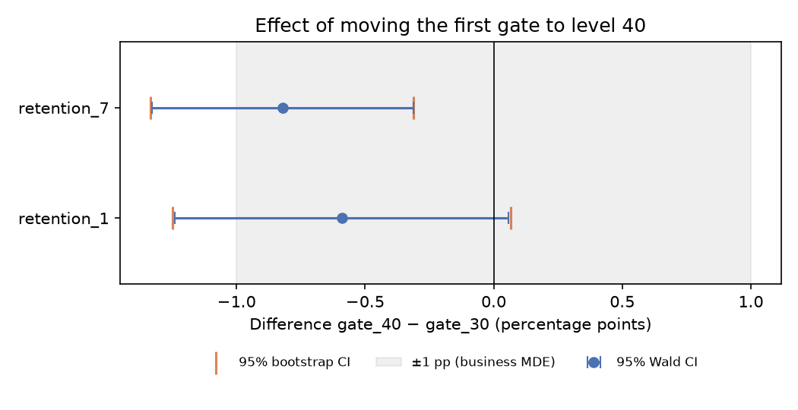
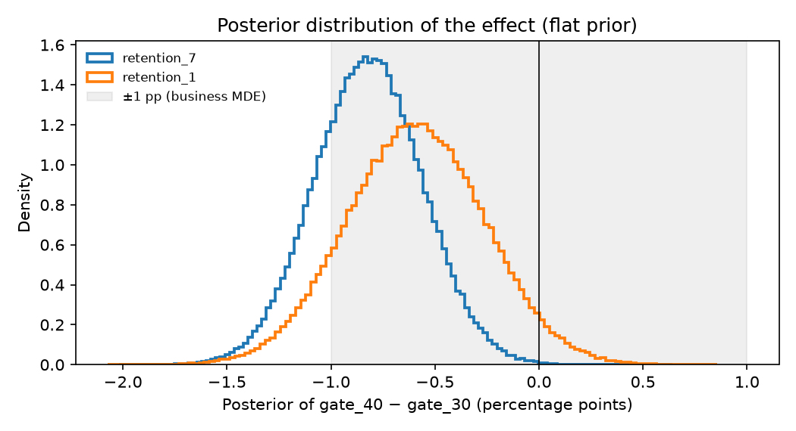
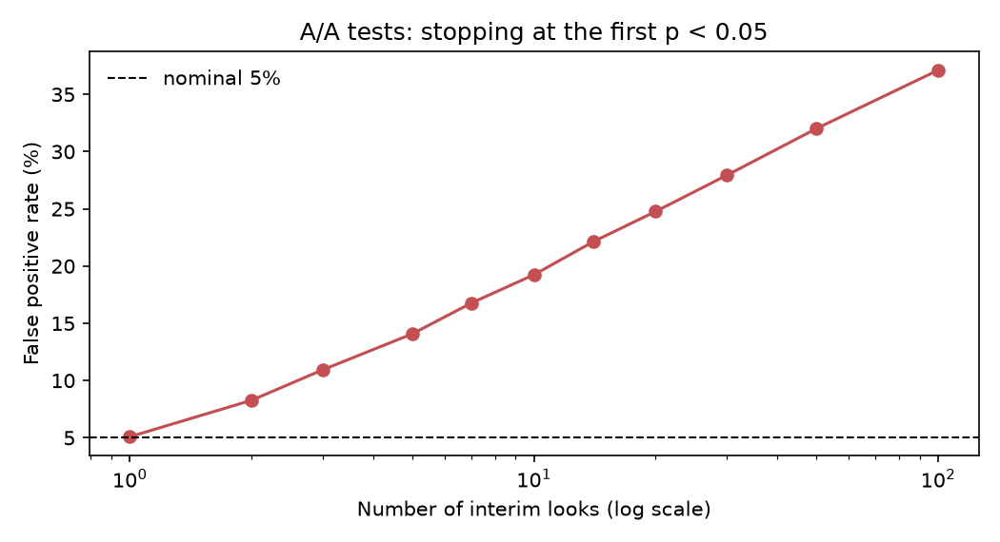
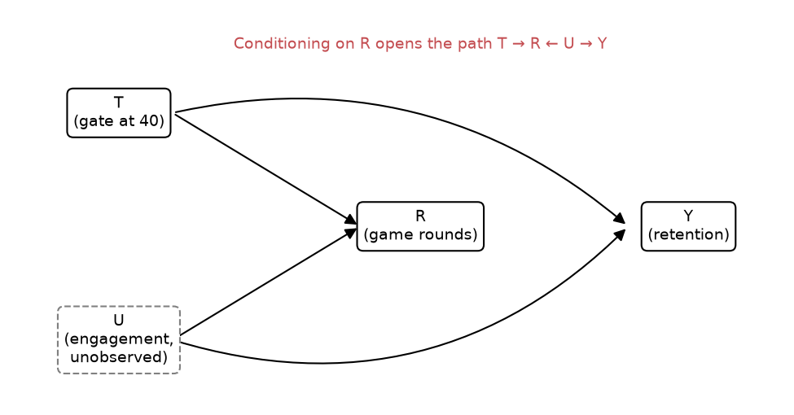
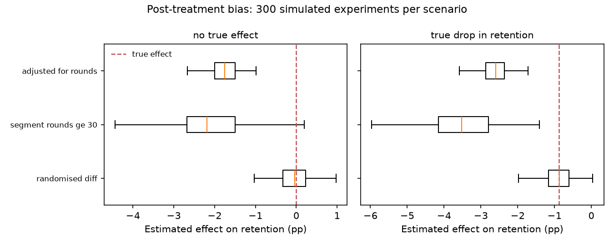

# Part 1 — Cookie Cats: analysing an A/B test properly

**Did moving the first gate of a mobile game from level 30 to level 40 change player retention?**

Cookie Cats is a mobile puzzle game where players hit "gates" that force them to wait or pay
before continuing. In a randomised experiment, about 90,000 new players were assigned either
to the original game (first gate at level 30) or to a version with the first gate at level 40.

This dataset is a classic. What this analysis adds is the process around the test: a
**pre-registered analysis plan**, validity checks done **blind to the results**, inference with
multiple-comparison control, a Bayesian reading for the business decision, and two simulations
of mistakes that are common in real A/B testing: peeking at results and segmenting by a
post-treatment variable.

## Result

**Keep the gate at level 30.** Moving it to level 40 lowered 7-day retention by
**0.82 percentage points** (19.02% → 18.20%, a 4.3% relative drop).

| Metric | Gate 30 | Gate 40 | Difference | 95% CI | p (Holm) |
|---|---:|---:|---:|---|---:|
| **7-day retention** (primary) | 19.02% | 18.20% | **−0.82 pp** | [−1.33, −0.31] | **0.003** |
| 1-day retention (secondary) | 44.82% | 44.23% | −0.59 pp | [−1.24, +0.06] | 0.074 |
| Game rounds, winsorised (guardrail) | 51.0 | 50.9 | −0.10 | [−1.36, +1.19] | — |



- The primary metric meets the pre-registered rule for a significant decrease. Bootstrap and
  Wald intervals agree to within 0.01 pp.
- The point estimate is below the 1 pp business threshold, but the interval reaches −1.33 pp:
  a harm larger than 1 pp cannot be ruled out.
- 1-day retention moves in the same direction but is not significant. The number of rounds
  played does not change.

### Bayesian reading of the same decision

| | 7-day retention | 1-day retention |
|---|---:|---:|
| Probability that gate 40 is better | 0.08% | 3.7% |
| Probability of a harm larger than 1 pp | 24% | 11% |
| Expected loss if we choose gate 40 | 0.82 pp | 0.60 pp |
| Expected loss if we choose gate 30 | < 0.001 pp | 0.005 pp |

With a flat prior. With a sceptical prior centred on the baseline and worth 10,000 players per
arm, the 7-day estimate shrinks to −0.67 pp and the conclusion is the same.



## How the analysis was done

### 1. Plan first, data second

[`analysis_plan.md`](analysis_plan.md) fixes the metrics, alpha, multiplicity correction, outlier
rule, validity thresholds and decision rule. It was committed to git **before** any outcome was
compared between groups (tag `plan-v1`), and `scripts/03_effect_estimation.py` refuses to run if
the plan is not committed or has uncommitted changes.

### 2. Design-stage power

With the assumed baselines and a 1 pp minimum effect of business interest, 23,665 players per arm
were needed for 7-day retention. The experiment enrolled about 44,700 per arm: **97% power**,
and a minimum detectable effect of 0.73 pp.

### 3. Validity checks, blind to the outcomes

These checks only use the size of each group and the pooled data, so running them cannot
influence later decisions.

- **Sample ratio mismatch: p = 0.0086.** Gate 40 got 50.44% of players instead of 50%. This is
  below the conventional 0.05 but above the stricter 0.001 threshold fixed in the plan, so the
  analysis goes ahead with the imbalance reported as a limitation. In a real company this would
  trigger an investigation of the assignment and logging pipeline before trusting the result.
- **Outliers:** one player logged 49,854 rounds in 14 days, 17 times the next one. Retention is
  unaffected; the rounds guardrail is winsorised at the pooled 99.9th percentile, as planned.
- **Inconsistencies:** 87 players with zero rounds are recorded as returning on day 1.

### 4. What peeking does to an A/B test (simulation)

Checking the p-value every day and stopping at the first p < 0.05 inflates false positives:
**22% with 14 daily looks** instead of 5%. Group-sequential boundaries fix it at a small cost.

| Strategy, 14 daily looks | False positives | Power at 1 pp | Average sample used if the effect is real |
|---|---:|---:|---:|
| Daily peeking at p < 0.05 | 22.0% | 87% | 48% |
| Pocock boundaries | 5.1% | 66% | 69% |
| O'Brien-Fleming boundaries | 5.0% | 78% | 76% |
| Fixed sample, one look | 5.0% | 80% | 100% |



The simulation is validated against real binomial data (19.2% vs 19.0% at 10 looks).

### 5. Why the analysis does not segment by engagement (simulation)

It is tempting to compare only "engaged" players, for example those who reached the first gate.
But the number of rounds is measured after assignment and depends on the treatment: moving the
gate lets players play more before hitting it. Conditioning on it compares groups that are no
longer randomised.



In simulations with a known truth:

| | True effect | Randomised comparison | Players with ≥ 30 rounds | Regression adjusting for rounds |
|---|---:|---:|---:|---:|
| No real effect | 0 pp | −0.02 pp | **−2.12 pp** | **−1.75 pp** |
| Real drop | −0.88 pp | −0.89 pp | **−3.49 pp** | **−2.61 pp** |

The randomised comparison is unbiased. The two tempting analyses invent an effect that does not
exist, or quadruple a real one.



## Limitations

- The sample ratio mismatch (p = 0.009) cannot be investigated with this data.
- No timestamps: novelty effects and test duration cannot be studied, and peeking is simulated.
- No pre-treatment covariates, so variance reduction (CUPED) is not possible.
- One game and one change: the effect size does not transfer to other games.

## How to run

From this folder, with `cookie_cats.csv` (Kaggle) in `data/`:

```bash
pip install -r ../requirements.txt
python -m pytest -q
python run_all.py
```

`run_all.py` runs scripts 01–07 in order and writes the full report to
[`results/REPORT.md`](results/REPORT.md).

| Script | Type | What it does |
|---|---|---|
| `01_power_analysis.py` | design | Required sample size and minimum detectable effect |
| `02_validity_checks.py` | confirmatory | SRM test and data quality, blind to outcomes by arm |
| `03_effect_estimation.py` | confirmatory | Retention effects, Holm correction, decision rule, guardrail |
| `04_bayesian_analysis.py` | exploratory | Beta-Binomial posteriors, expected loss, prior sensitivity |
| `05_peeking_simulation.py` | exploratory | False positives from peeking; Pocock and O'Brien-Fleming designs |
| `06_post_treatment_bias.py` | exploratory | Simulation of bias from segmenting by game rounds |
| `07_build_report.py` | — | Assembles all outputs into `results/REPORT.md` |
