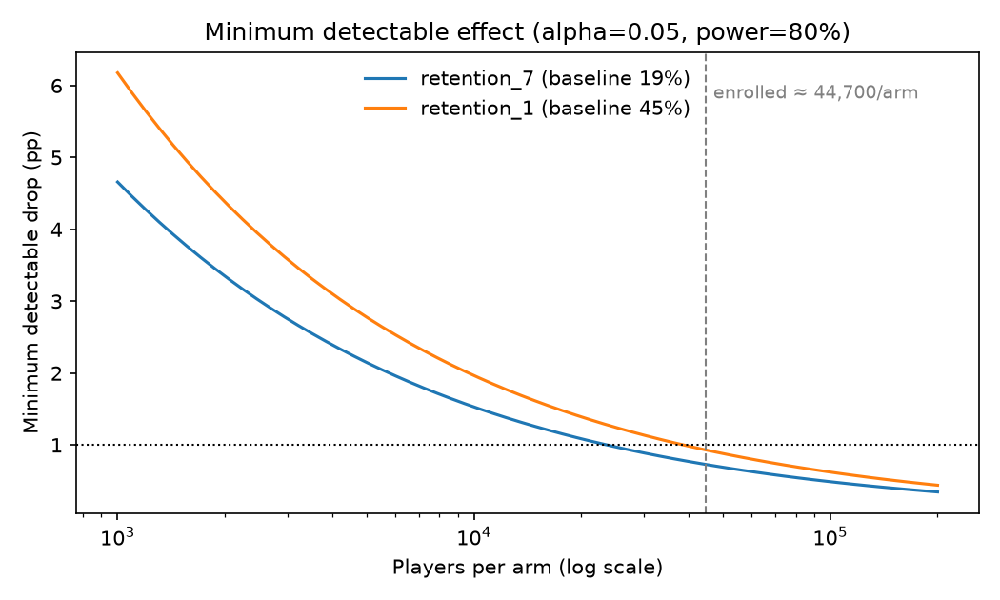
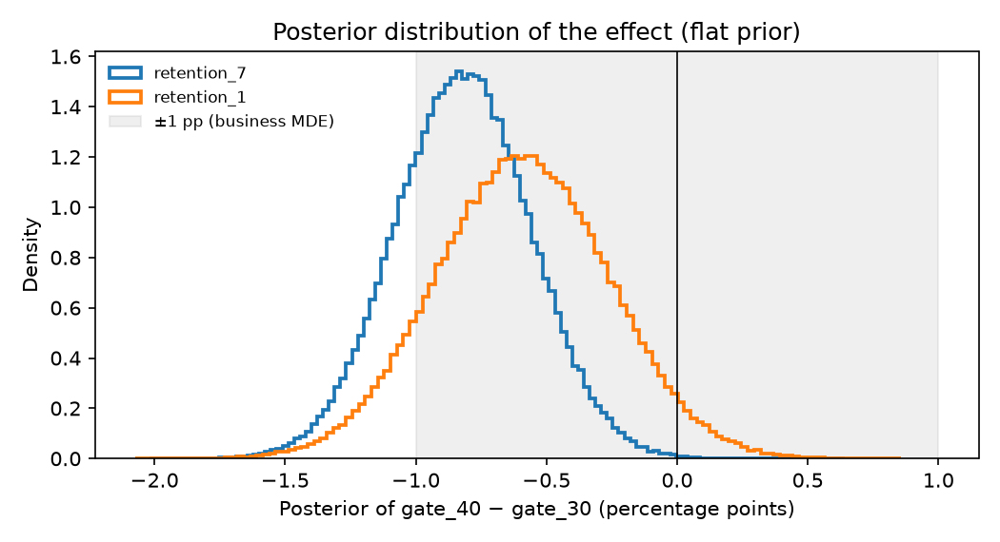
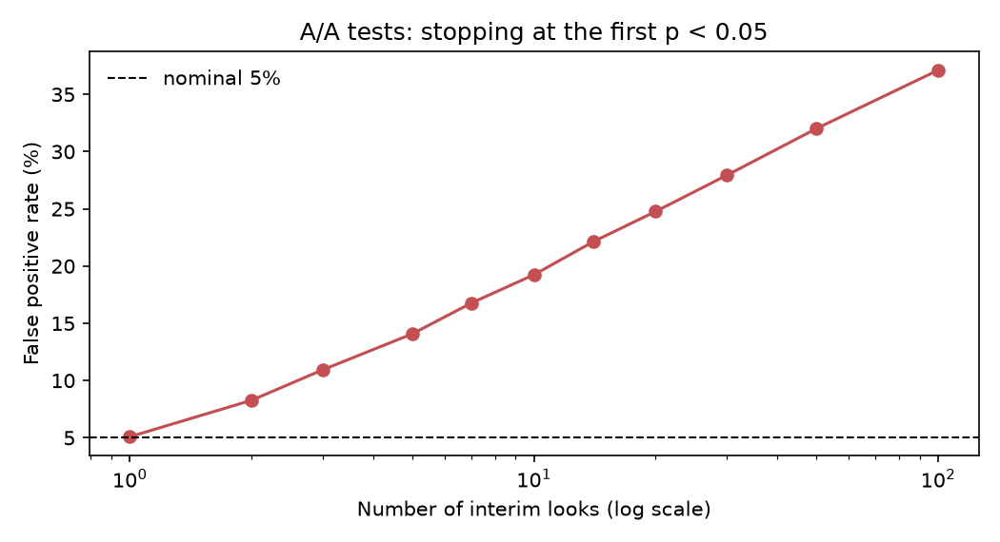
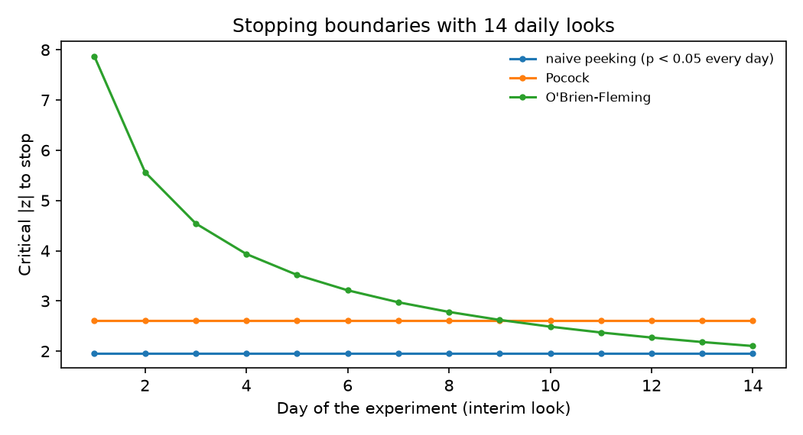
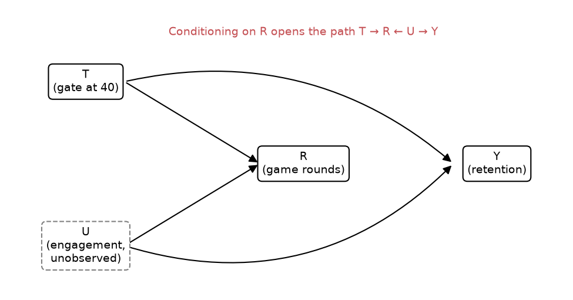
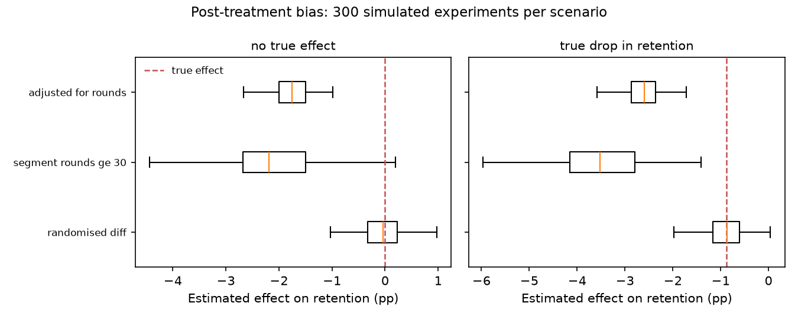

# Part 1 — Cookie Cats A/B test: full report

Confirmatory sections follow the pre-registered `analysis_plan.md`. Exploratory sections are labelled as such.

## Contents

1. [Design-stage power](#1-design-stage-power) — _confirmatory design_
2. [Validity checks](#2-validity-checks) — _confirmatory_
3. [Effect estimation](#3-effect-estimation) — _confirmatory_
4. [Bayesian analysis](#4-bayesian-analysis) — _exploratory_
5. [Peeking and sequential testing](#5-peeking-and-sequential-testing) — _exploratory_
6. [Post-treatment bias](#6-post-treatment-bias) — _exploratory_

## 1. Design-stage power

_confirmatory design_

| Metric | Baseline | MDE | Required n/arm | Enrolled n/arm | Achieved MDE | Power at MDE |
|---|---:|---:|---:|---:|---:|---:|
| retention_7 | 19% | 1 pp | 23,665 | 44,700 | 0.73 pp | 97.1% |
| retention_1 | 45% | 1 pp | 38,769 | 44,700 | 0.93 pp | 85.3% |



## 2. Validity checks

_confirmatory_

### Validity checks (blind to outcomes by arm)

#### Sample ratio mismatch

| Arm | Observed | Expected | Share |
|---|---:|---:|---:|
| gate_30 | 44,700 | 45,094.5 | 0.4956 |
| gate_40 | 45,489 | 45,094.5 | 0.5044 |

Chi-square = 6.902, p-value = 0.008608 (threshold alpha_SRM = 0.001).

No SRM detected at the pre-specified threshold.

#### Pooled data quality

```json
{
  "n_players": 90189,
  "n_unique_userid": 90189,
  "share_zero_rounds": 0.0442847797403231,
  "n_zero_rounds_but_retained_d1": 87,
  "n_zero_rounds_but_retained_d7": 29,
  "n_retained_d7_not_d1": 3599,
  "rounds_quantiles": {
    "p50": 16.0,
    "p75": 51.0,
    "p90": 134.0,
    "p99": 493.0,
    "p99.9": 1073.6240000000107
  },
  "rounds_max": 49854
}
```

#### Most extreme players by game rounds (pooled)

|   userid |   sum_gamerounds |   robust_z_log | above_hard_cap   |
|---------:|-----------------:|---------------:|:-----------------|
|  6390605 |            49854 |           4.99 | True             |
|   871500 |             2961 |           3.23 | False            |
|  3271615 |             2640 |           3.15 | False            |
|  4832608 |             2438 |           3.10 | False            |
|  5346171 |             2294 |           3.07 | False            |
|  5133952 |             2251 |           3.06 | False            |
|  9640085 |             2156 |           3.03 | False            |
|  4090246 |             2124 |           3.02 | False            |
|  9791599 |             2063 |           3.00 | False            |
|   725080 |             2015 |           2.99 | False            |

## 3. Effect estimation

_confirmatory_

### Effect estimation (confirmatory)

_Plan committed in c82a6af 2026-11-11 11:20:55 +0100_

#### Decision (primary metric, rule from §7 of the plan)

**Significant decrease with gate_40: keep the gate at level 30**

#### Retention

| Metric | Control | Treatment | Diff | 95% Wald CI | 95% bootstrap CI | Rel. lift | p | p (Holm) |
|---|---:|---:|---:|---|---|---:|---:|---:|
| retention_7 (primary) | 0.1902 | 0.1820 | -0.82 pp | [-1.33 pp, -0.31 pp] | [-1.34 pp, -0.31 pp] | -4.31% | 0.0016 | 0.0031 |
| retention_1 (secondary) | 0.4482 | 0.4423 | -0.59 pp | [-1.24 pp, +0.06 pp] | [-1.25 pp, +0.07 pp] | -1.32% | 0.0744 | 0.0744 |

#### Guardrail: game rounds in the first 14 days

| Version | Mean C | Mean T | Median C | Median T | Diff in means | 95% bootstrap CI |
|---|---:|---:|---:|---:|---:|---|
| raw | 52.46 | 51.30 | 17 | 16 | -1.16 | [-4.10, +0.95] |
| winsorised (cap=1074) | 51.03 | 50.94 | 17 | 16 | -0.10 | [-1.36, +1.19] |

Mann-Whitney U p-value: 0.0502

Guardrail: no significant drop on the winsorised metric.

## 4. Bayesian analysis

_exploratory_

### Bayesian analysis (exploratory)

Beta-Binomial model; 200,000 posterior draws per arm. Expected loss = average retention lost (in pp) if we choose that arm and the other is actually better.

| Metric | Prior | Diff (pp) | 95% CrI (pp) | P(T better) | P(harm > MDE) | Exp. loss choose T (pp) | Exp. loss choose C (pp) |
|---|---|---:|---|---:|---:|---:|---:|
| retention_7 | flat Beta(1,1) | -0.819 | [-1.328, -0.309] | 0.0008 | 0.2440 | 0.8195 | 0.0001 |
| retention_7 | baseline-centred, 1k players | -0.802 | [-1.306, -0.297] | 0.0009 | 0.2197 | 0.8016 | 0.0001 |
| retention_7 | baseline-centred, 10k players | -0.672 | [-1.133, -0.212] | 0.0020 | 0.0818 | 0.6724 | 0.0001 |
| retention_1 | flat Beta(1,1) | -0.592 | [-1.240, +0.057] | 0.0366 | 0.1095 | 0.5965 | 0.0049 |
| retention_1 | baseline-centred, 1k players | -0.580 | [-1.222, +0.061] | 0.0382 | 0.0986 | 0.5847 | 0.0051 |
| retention_1 | baseline-centred, 10k players | -0.485 | [-1.072, +0.104] | 0.0529 | 0.0430 | 0.4914 | 0.0067 |



## 5. Peeking and sequential testing

_exploratory_

### Peeking and sequential testing (exploratory, simulation)

Design: baseline D7 = 19%, MDE = 1 pp, fixed-sample size 23,665 players/arm (80% power). 100,000 simulated experiments per scenario.

#### A. False positive rate when peeking

| Looks | False positive rate |
|---:|---:|
| 1 | 5.1% |
| 2 | 8.3% |
| 3 | 10.9% |
| 5 | 14.1% |
| 7 | 16.8% |
| 10 | 19.2% |
| 14 | 22.1% |
| 20 | 24.8% |
| 30 | 27.9% |
| 50 | 32.0% |
| 100 | 37.1% |

Validation at 10 looks: Brownian approximation 19.2% vs binomial simulation 19.0%.



#### B. Fourteen daily looks

| Strategy | Type I error | Power at MDE | E[sample] under H0 | E[sample] under H1 |
|---|---:|---:|---:|---:|
| naive peeking (p < 0.05 every day) | 22.0% | 87.0% | 86% | 48% |
| Pocock | 5.1% | 66.0% | 97% | 69% |
| O'Brien-Fleming | 5.0% | 77.6% | 99% | 76% |
| fixed sample (one look at the end) | 5.0% | 80.0% | 100% | 100% |



## 6. Post-treatment bias

_exploratory_

### Why we do not segment by game rounds (exploratory, simulation)

Synthetic players with latent engagement U. The treatment increases game rounds (more levels before the first gate). Estimates are compared with the known true effect.



| Scenario | Method | True effect (pp) | Mean estimate (pp) | Bias (pp) |
|---|---|---:|---:|---:|
| no true effect | randomised_diff | +0.00 | -0.02 | -0.02 |
| no true effect | segment_rounds_ge_30 | +0.00 | -2.12 | -2.12 |
| no true effect | adjusted_for_rounds | +0.00 | -1.75 | -1.75 |
| true drop in retention | randomised_diff | -0.88 | -0.89 | -0.01 |
| true drop in retention | segment_rounds_ge_30 | -0.88 | -3.49 | -2.61 |
| true drop in retention | adjusted_for_rounds | -0.88 | -2.61 | -1.73 |


