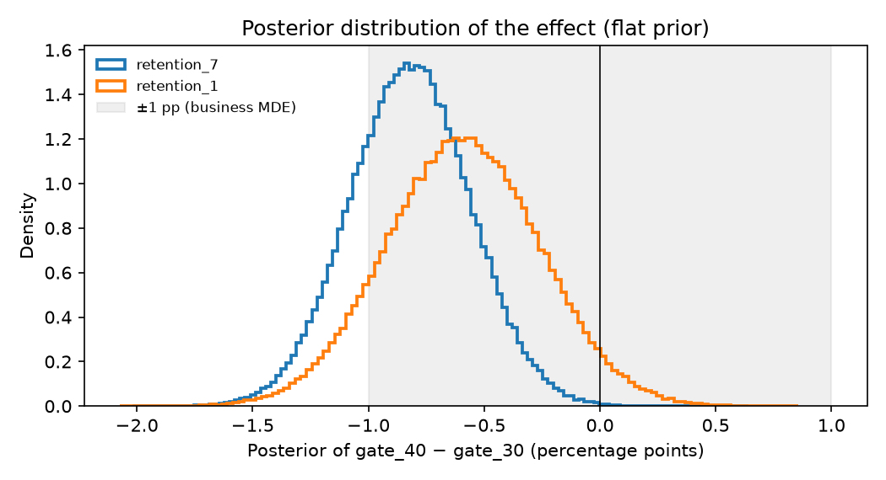

# Bayesian analysis (exploratory)

Beta-Binomial model; 200,000 posterior draws per arm. Expected loss = average retention lost (in pp) if we choose that arm and the other is actually better.

| Metric | Prior | Diff (pp) | 95% CrI (pp) | P(T better) | P(harm > MDE) | Exp. loss choose T (pp) | Exp. loss choose C (pp) |
|---|---|---:|---|---:|---:|---:|---:|
| retention_7 | flat Beta(1,1) | -0.819 | [-1.328, -0.309] | 0.0008 | 0.2440 | 0.8195 | 0.0001 |
| retention_7 | baseline-centred, 1k players | -0.802 | [-1.306, -0.297] | 0.0009 | 0.2197 | 0.8016 | 0.0001 |
| retention_7 | baseline-centred, 10k players | -0.672 | [-1.133, -0.212] | 0.0020 | 0.0818 | 0.6724 | 0.0001 |
| retention_1 | flat Beta(1,1) | -0.592 | [-1.240, +0.057] | 0.0366 | 0.1095 | 0.5965 | 0.0049 |
| retention_1 | baseline-centred, 1k players | -0.580 | [-1.222, +0.061] | 0.0382 | 0.0986 | 0.5847 | 0.0051 |
| retention_1 | baseline-centred, 10k players | -0.485 | [-1.072, +0.104] | 0.0529 | 0.0430 | 0.4914 | 0.0067 |

