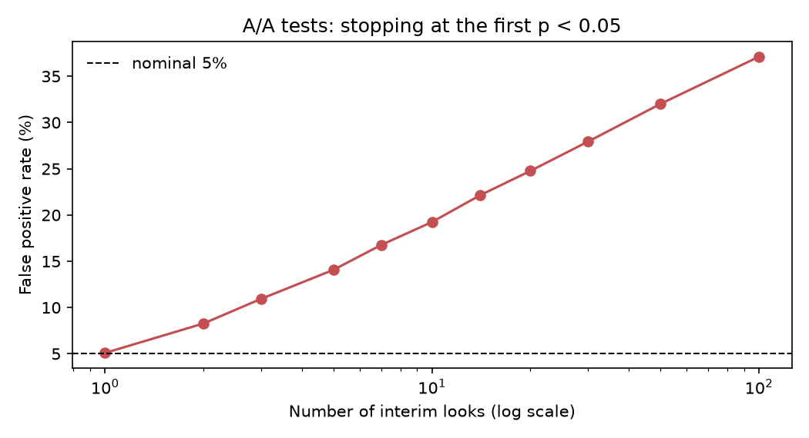
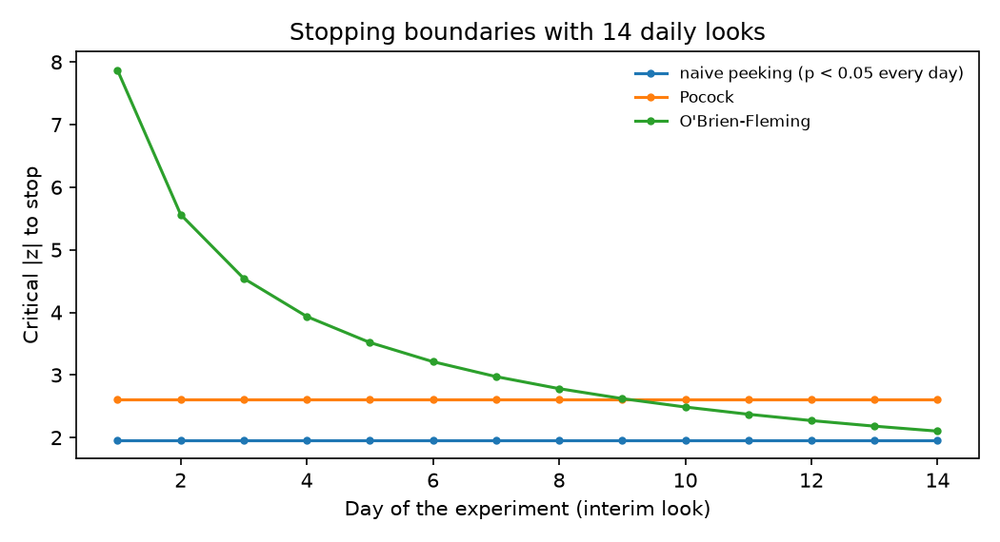

# Peeking and sequential testing (exploratory, simulation)

Design: baseline D7 = 19%, MDE = 1 pp, fixed-sample size 23,665 players/arm (80% power). 100,000 simulated experiments per scenario.

## A. False positive rate when peeking

| Looks | False positive rate |
|---:|---:|
| 1 | 5.1% |
| 2 | 8.3% |
| 3 | 10.9% |
| 5 | 14.1% |
| 7 | 16.8% |
| 10 | 19.2% |
| 14 | 22.1% |
| 20 | 24.8% |
| 30 | 27.9% |
| 50 | 32.0% |
| 100 | 37.1% |

Validation at 10 looks: Brownian approximation 19.2% vs binomial simulation 19.0%.

## B. Fourteen daily looks

| Strategy | Type I error | Power at MDE | E[sample] under H0 | E[sample] under H1 |
|---|---:|---:|---:|---:|
| naive peeking (p < 0.05 every day) | 22.0% | 87.0% | 86% | 48% |
| Pocock | 5.1% | 66.0% | 97% | 69% |
| O'Brien-Fleming | 5.0% | 77.6% | 99% | 76% |
| fixed sample (one look at the end) | 5.0% | 80.0% | 100% | 100% |

