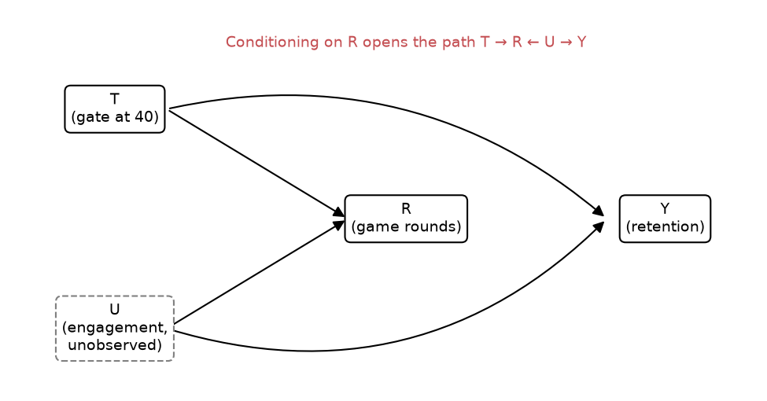
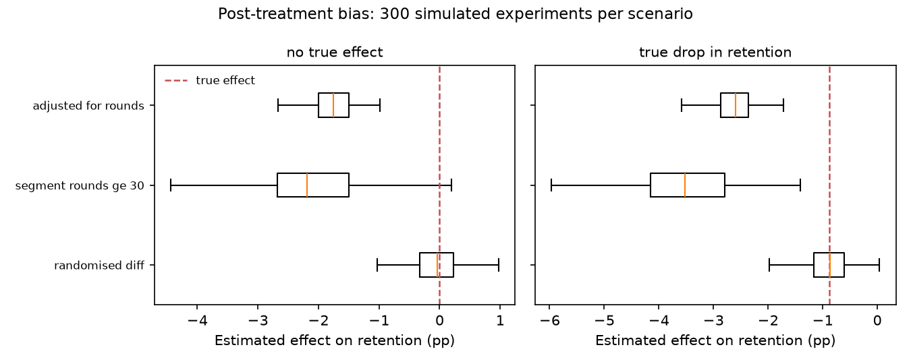

# Why we do not segment by game rounds (exploratory, simulation)

Synthetic players with latent engagement U. The treatment increases game rounds (more levels before the first gate). Estimates are compared with the known true effect.

| Scenario | Method | True effect (pp) | Mean estimate (pp) | Bias (pp) |
|---|---|---:|---:|---:|
| no true effect | randomised_diff | +0.00 | -0.02 | -0.02 |
| no true effect | segment_rounds_ge_30 | +0.00 | -2.12 | -2.12 |
| no true effect | adjusted_for_rounds | +0.00 | -1.75 | -1.75 |
| true drop in retention | randomised_diff | -0.88 | -0.89 | -0.01 |
| true drop in retention | segment_rounds_ge_30 | -0.88 | -3.49 | -2.61 |
| true drop in retention | adjusted_for_rounds | -0.88 | -2.61 | -1.73 |

