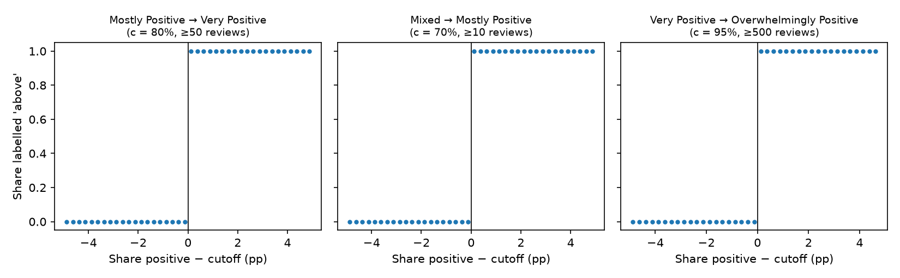
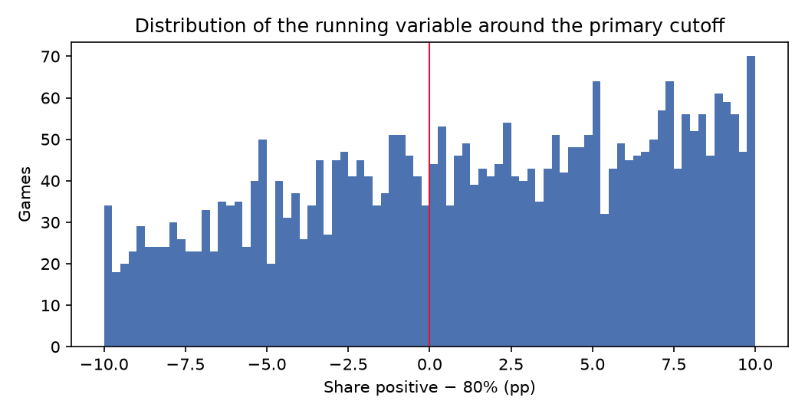

# Snapshot t1: inspection (no outcome data)

Games with a valid summary: 26,294.

## review_score code vs label

|   review_score_t1 |   1 user reviews |   2 user reviews |   3 user reviews |   4 user reviews |   5 user reviews |   6 user reviews |   7 user reviews |   8 user reviews |   9 user reviews |   Mixed |   Mostly Negative |   Mostly Positive |   Negative |   No user reviews |   Overwhelmingly Positive |   Positive |   Very Negative |   Very Positive |
|------------------:|-----------------:|-----------------:|-----------------:|-----------------:|-----------------:|-----------------:|-----------------:|-----------------:|-----------------:|--------:|------------------:|------------------:|-----------:|------------------:|--------------------------:|-----------:|----------------:|----------------:|
|                 0 |             1258 |              853 |              620 |              512 |              463 |              362 |              290 |              270 |              219 |       0 |                 0 |                 0 |          0 |             10570 |                         0 |          0 |               0 |               0 |
|                 2 |                0 |                0 |                0 |                0 |                0 |                0 |                0 |                0 |                0 |       0 |                 0 |                 0 |          0 |                 0 |                         0 |          0 |               4 |               0 |
|                 3 |                0 |                0 |                0 |                0 |                0 |                0 |                0 |                0 |                0 |       0 |                 0 |                 0 |         34 |                 0 |                         0 |          0 |               0 |               0 |
|                 4 |                0 |                0 |                0 |                0 |                0 |                0 |                0 |                0 |                0 |       0 |               279 |                 0 |          0 |                 0 |                         0 |          0 |               0 |               0 |
|                 5 |                0 |                0 |                0 |                0 |                0 |                0 |                0 |                0 |                0 |    2088 |                 0 |                 0 |          0 |                 0 |                         0 |          0 |               0 |               0 |
|                 6 |                0 |                0 |                0 |                0 |                0 |                0 |                0 |                0 |                0 |       0 |                 0 |              2008 |          0 |                 0 |                         0 |          0 |               0 |               0 |
|                 7 |                0 |                0 |                0 |                0 |                0 |                0 |                0 |                0 |                0 |       0 |                 0 |                 0 |          0 |                 0 |                         0 |       2562 |               0 |               0 |
|                 8 |                0 |                0 |                0 |                0 |                0 |                0 |                0 |                0 |                0 |       0 |                 0 |                 0 |          0 |                 0 |                         0 |          0 |               0 |            3496 |
|                 9 |                0 |                0 |                0 |                0 |                0 |                0 |                0 |                0 |                0 |       0 |                 0 |                 0 |          0 |                 0 |                       406 |          0 |               0 |               0 |

**Codes with unexpected labels:** {0: 'No user reviews'}

## Cutoffs

| cutoff       |   theoretical_c |   min_reviews |   n_eligible |   max_pct_labelled_below |   min_pct_labelled_above |   compliance |   n_within_2pp |   n_within_5pp |   density_p_value |
|:-------------|----------------:|--------------:|-------------:|-------------------------:|-------------------------:|-------------:|---------------:|---------------:|------------------:|
| primary_80   |          0.8000 |            50 |         6444 |                   0.7999 |                   0.8000 |       1.0000 |            684 |           1662 |            0.8016 |
| secondary_70 |          0.7000 |            10 |        10877 |                   0.6997 |                   0.7000 |       1.0000 |            659 |           1545 |            0.6452 |
| secondary_95 |          0.9500 |           500 |         2523 |                   0.9499 |                   0.9500 |       1.0000 |            554 |           1020 |            0.8288 |

